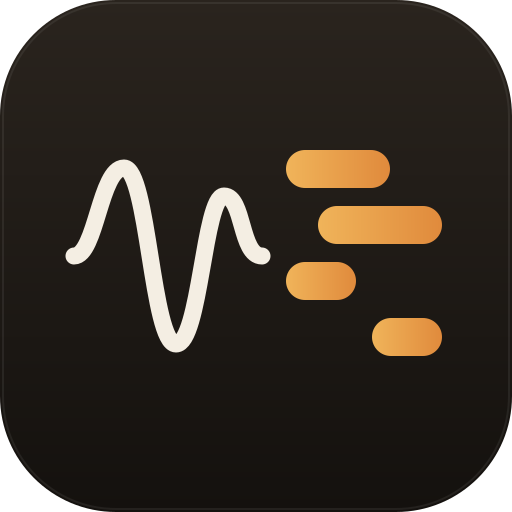

<p align="center">
  
</p>

<h1 align="center">Notewright</h1>

<p align="center">
  Piano audio to MIDI. Accurate, private, and free of dependencies.<br>
  Runs in any modern browser and as an Android app, from the same code.
</p>

---

Drop in a recording of solo piano and get a MIDI file with every note, its
timing to the millisecond, its length and how hard it was played. A built-in
piano roll lets you check the result against the original, by ear.

- **Private.** All analysis happens on your device. Audio is never uploaded.
- **Built for piano.** Models the stiffness-stretched partials of real strings
  and learns from thousands of synthetic pianos, instead of generic pitch tracking.
- **Reverb-aware.** New notes are told apart from room tails, echoes and held
  pedal, and faint notes are judged by their own harmonic pattern rather than
  by how loud they are.
- **Zero runtime dependencies.** No libraries, no models to download, no server.
  The web app is a single HTML file (about 3 MB, piano included). The Android app uses only the Android framework.
- **Precise timing.** MIDI is written at 960 ticks per quarter note and a fixed
  120 BPM, so one tick is about a millisecond and nothing gets quantised away.

## Using it

**Web.** Open `index.html` from the [latest release](../../releases/latest) in a
browser, or host it anywhere static (GitHub Pages works). Choose or drag in an
MP3, WAV, M4A, FLAC or OGG file, press *Convert*, then play the result or
download the `.mid`.

**Android.** Install the APK from the latest release. The app is the same web
build inside a WebView, with a native file picker and a "save as" dialog.

Long recordings take longer. On a desktop PC conversion runs several times
faster than real time (a 12-minute recording takes a few minutes); phones are
slower. Everything stays on the device, and accuracy was never traded for speed.

### Options

| Option | What it does |
| --- | --- |
| Sensitivity | Slide toward *Cleaner* to drop doubtful notes, toward *Catch faint notes* to keep more. |
| Note length | *As played* follows the sound, including pedal. *Tight* ends notes at the first sign of release. |
| Tuning | *Detect* measures how far the recording is from A = 440 Hz and compensates. |

## The piano you hear

The preview uses 30 samples of a real Yamaha C5 grand (Salamander Grand
Piano by Alexander Holm, CC BY 3.0), packed into the app. See
[NOTICE.md](NOTICE.md). The MIDI file itself contains no sound; use it with
any instrument you like.

## How accurate is it?

Honest answer: very good on timing, good on pitch for most music, and still
imperfect on the hardest material. No transcriber, including this one, is
100% on real piano recordings.

Measured on **held-out synthetic pieces** (40 seconds each, eight different
simulated pianos and rooms, 1,404 notes; none of this audio or these pianos
were used in training):

| | |
| --- | --- |
| Notes found and correct (recall) | 70% overall, 76 to 87% on the less reverberant pieces |
| Detections that are real notes (precision) | 84% overall, 89 to 95% on the less reverberant pieces |
| Note-level F1 (pitch exact, onset within 50 ms) | 0.77 overall; 0.82 to 0.91 on the cleaner pieces, 0.61 to 0.67 on the hardest |
| Median onset error | 1 to 5 ms |
| Same pieces after simulated MP3 damage | F1 0.76 |

The hard cases are the ones you would expect: a dense passage of big pedalled
chords inside a very reverberant room with echo (F1 about 0.6), trills and
tremolo faster than about 12 notes per second, and an octave doubling that is
exactly as loud as the note beneath it. Roughly 40% of the remaining errors
involve a harmonic relationship (an octave, a fifth or a twelfth).

Note lengths are the weakest part. A length counts as right when it lands within
20% (and at least 50 ms) of the true one: that is true for about 70% of notes
played without pedal and 60% overall. With the sustain pedal down a note is
followed only for as long as it stays audible, so long pedalled notes tend to
come out shorter than the pedal held them (43% within tolerance). The
conversion cannot see the pedal, only its effect on the sound.

These numbers come from simulated pianos because that is the only audio with
exactly known notes that could be produced without anyone's recordings. How the
engine does on a given real recording depends on the piano and the room. If you
find a passage that goes wrong, the issue template asks for a short clip so it
can be added to the evaluation.

## Building

You need Node 18 or newer. The web app has no install step.

```bash
npm start            # dev server at http://localhost:8080/web/index.html
npm test             # unit tests and a short end-to-end check
npm run build        # dist/web/index.html (single file)
```

Android needs JDK 17 and the Android SDK (API 36):

```bash
cd android
./gradlew assembleDebug        # app/build/outputs/apk/debug/app-debug.apk
./gradlew assembleRelease      # signed if android/keystore.properties exists
```

Gradle runs the web build first, so Node must be on `PATH`.

## Project layout

```
core/       the engine: spectrogram, features, networks, MIDI, synth (plain ES modules)
web/        the user interface
android/    Gradle project: a thin WebView shell around the web build
tools/      synthetic piano generator, training scripts, evaluation, dev helpers
scripts/    build and release scripts
docs/       algorithm notes, ads setup, release process
test/       node:test suites
```

How the engine works is written up in [docs/ALGORITHM.md](docs/ALGORITHM.md).

## Retraining the networks

The shipped weights in `core/models.js` are produced by the scripts in `tools/`
(see [tools/README.md](tools/README.md) for the full recipe): render synthetic
pianos once, derive features from the cached audio, train with numpy, embed.

```bash
node tools/render_piece.mjs <seed> <audioDir>           # synthetic piece + ground truth
node tools/feat_piece.mjs <seed> <audioDir> <featDir>   # training rows (fast)
python tools/train_nn.py <featDir> onset.json 12 256,128,64 160 p
node scripts/embed-models.mjs onset.json offset.json refine.json
node tools/sweep.mjs <valDir> --onset onset.json --refine refine.json
```

Training data is generated, not collected: nothing in the repository is derived
from anyone's recordings.

## Hosting the web version

It is a static site (`dist/web`), so any static host works.

- **GitHub Pages:** the `Deploy web app` workflow publishes it on every push to `main`. In the repository settings set *Pages > Source* to *GitHub Actions*.
- **Netlify:** connect the repository; `netlify.toml` already holds the build command and the publish folder.

The public website runs without ads (see [docs/ADS.md](docs/ADS.md)).

## Releases and updates

Releases are built by GitHub Actions when a `v*` tag is pushed and attach the
single-file web app and the APK. The app checks the latest release for updates.
See [docs/RELEASING.md](docs/RELEASING.md).

## Ads

Each conversion unlocks after one rewarded ad, with a small banner on the home
and result screens and a consent form where the law requires one. Until an ad
account is configured, labelled placeholders stand in. Setup for AdMob, AdSense
and Ad Manager, and how to earn more from it, is in [docs/ADS.md](docs/ADS.md);
the privacy policy page is .

## Contributing

Issues and pull requests are welcome. For accuracy problems, a short clip that
reproduces the issue is the most useful thing you can attach. See
[CONTRIBUTING.md](CONTRIBUTING.md).

## Licence

MIT. See [LICENSE](LICENSE).
